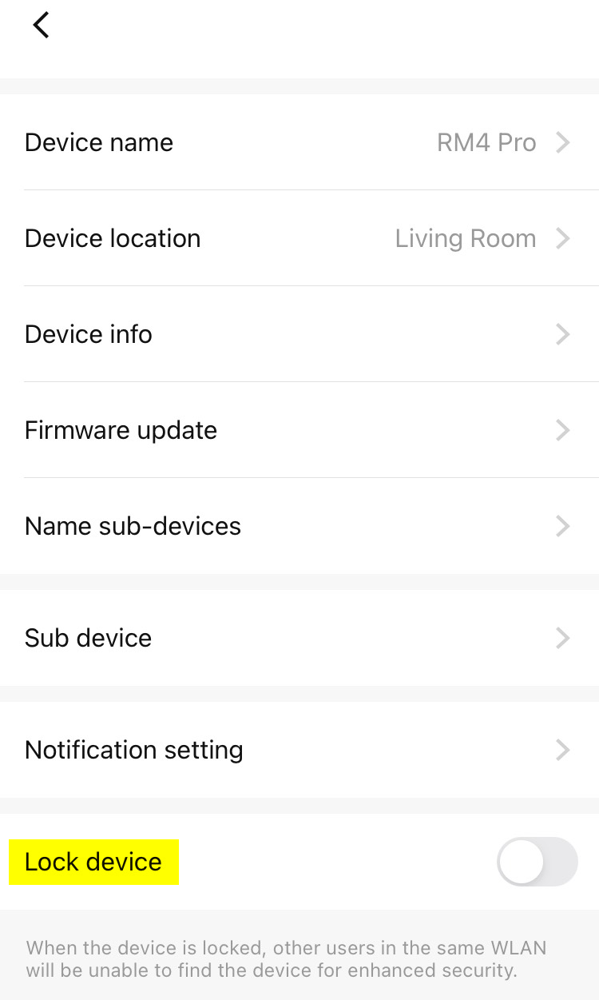

# Homebridge Broadlink RM v5

[](https://github.com/mrclmrvn/homebridge-broadlink-rm/actions/workflows/pipeline.yml)

Control IR/RF appliances from Apple Home and Siri through Homebridge and Broadlink
RM hardware. Configure accessories for your appliances and reuse their learned
remote-control codes.

This fork continues the Broadlink RM plugin as a TypeScript-based v5 rebuild,
packaged as `@mrclmrvn/homebridge-broadlink-rm`.

**Alpha status:** every legacy accessory type name now has a v5 implementation,
but full legacy configuration compatibility and physical-device validation remain
incomplete. Existing hex codes can be reused; advanced options may need changes.
Read the [migration guide](docs/migration.md) before replacing an installation.

## Requirements and hardware

- **Homebridge:** declared support is `^1.6.0 || ^2.0.0`.
  [Automated version coverage](docs/homebridge-compatibility.md) exercises
  1.6.0, 1.11.4, 2.0.0 and 2.5.0; live integration still needs validation.
- **Node.js:** 22.12+ within 22.x, or Node 24/26. Choose a version supported by
  both this plugin and your Homebridge release; older Homebridge versions may
  exclude Node 26.
- **Broadlink hardware:** the driver includes RM2/RM3 and RM4 protocol paths,
  covering Mini/Pro variants in its device table. RF requires an RF-capable
  device and matching frequency; temperature/humidity readings require the
  relevant built-in or cable sensor. Model-specific operation needs validation.
- **Network access:** Homebridge must be able to reach the RM on the local
  network. Discovery uses broadcasts; static hosts are available when needed.
  See [network troubleshooting](docs/troubleshooting.md#discovery-finds-nothing).

## Start here

1. Clone the repository, install development dependencies, and build/check the
   package. If you already have a checkout, run the npm commands there:

   ```bash
   git clone https://github.com/mrclmrvn/homebridge-broadlink-rm.git
   cd homebridge-broadlink-rm
   npm ci
   npm run test:homebridge
   npm pack
   ```

2. On the machine running Homebridge, install the resulting local tarball using
   the same installation environment as your Homebridge service:

   ```bash
   npm install -g ./mrclmrvn-homebridge-broadlink-rm-5.0.0-alpha.1.tgz
   ```

3. Add this `BroadlinkRM` object to the existing `platforms` array in your
   Homebridge config. Start with discovery and an IR learning button, then add
   accessories with your actual codes:

   ```json
   {
     "platform": "BroadlinkRM",
     "name": "Broadlink RM",
     "disableDiscovery": false,
     "accessories": [
       { "name": "Learn IR", "type": "learn-code" }
     ]
   }
   ```

4. Restart Homebridge. Turn on Learn IR to capture a remote button and copy the
   logged hex code into an accessory's data configuration. TVs require separate
   HomeKit pairing; other types are bridged.

Automatic discovery repeats hourly by default; [rediscovery settings](docs/rediscovery.md)
explain interval, disable and MAC-selection behavior. Configure accessories using
the existing schema or JSON, and capture codes with learning accessories or the CLI.

This is a source/tarball installation path, not confirmation that an npm release
or alpha dist-tag has been published. Release-head CI and live integration
validation remain required.

See [installation and configuration](docs/setup.md) for static hosts, multiple
RM devices, platform options, and a [v5 sample config](config-v5-sample.json).

## Accessory guides

| Accessories | Configuration |
| --- | --- |
| Air conditioner / Thermostat | [Setup](docs/setup.md), [mode/default options](docs/air-conditioner.md) |
| Switches, IR learning | [Setup guide](docs/setup.md) |
| Fan / Fanv2 | [Fan](docs/fan.md) |
| Television, inputs, remote, volume | [TV and pairing](docs/tv.md) |
| Light, brightness, color presets | [Light](docs/light.md) |
| Window covering, garage door, lock | [Movement and lock controls](docs/moving-accessories.md) |
| Humidifier/dehumidifier, purifier, sensors, HeaterCooler | [Remaining types](docs/remaining-accessories.md) |
| Outlet, Window, Fan v1, switch variants | [Remaining types](docs/remaining-accessories.md#type-coverage) |

Reported power, movement, and lock state are generally inferred from successful
commands and timers. Real sensor readings are available only from supported
Broadlink hardware, file sources, or MQTT measurements. See each guide for failure
handling and unsupported options.

## Troubleshooting and bug reports

Documentation is available in the [setup guide](docs/setup.md) and
[accessory guides](#accessory-guides). If you still have trouble after reading
them, [open an issue](https://github.com/mrclmrvn/homebridge-broadlink-rm/issues/new)
and we'll help as best we can.

If discovery finds nothing, check reachability from the machine or container
running Homebridge and review [discovery troubleshooting](docs/troubleshooting.md#discovery-finds-nothing).

### Unlock local control in the Broadlink app

The Broadlink device's cloud lock can prevent discovery or local connections.
If your device is locked, follow these steps:

1. Open the [Broadlink app](https://apps.apple.com/us/app/broadlink/id1450257910).
2. From the Home screen, tap your Broadlink device.
3. Tap **…** in the top right.
4. Scroll down and toggle **Lock device** to **Off**.
5. Tap **OK** when prompted **Confirm to unlock the device**.



Screenshot retained from the [previous maintainer's documentation](https://github.com/kiwi-cam/homebridge-broadlink-rm#documentation).
App navigation may vary by version. Retry discovery or authentication after
unlocking; see [authentication troubleshooting](docs/troubleshooting.md#authentication-or-sends-fail)
if local connections still fail.

For reproducible problems, [open an issue](https://github.com/mrclmrvn/homebridge-broadlink-rm/issues/new)
with the plugin, Homebridge and Node versions; RM model/device ID; relevant
configuration; and logs showing the error and expected behavior. Redact passwords,
MQTT credentials and Homebridge pairing codes. Include whether the problem
occurs after restart or only with a particular command or sensor source.

## Diagnostics and development

- [Scheduled rediscovery](docs/rediscovery.md): late-device recovery, DHCP address
  changes, static hosts and shutdown behavior.
- [Sensor sources](docs/sensor-sources.md): 1-wire, explicit pseudo temperatures,
  source precedence and optional battery telemetry.
- [Power and feedback](docs/power-and-feedback.md): Ping/ARP estimates, shared
  command sequences, garage endpoints/obstruction and lock-bolt sensors.
- [MQTT sensors](docs/mqtt.md): legacy topics, Zigbee2MQTT JSON, credentials,
  freshness, and integration with AC, HeaterCooler and humidity controllers.
- [Driver and protocol update](docs/protocol.md): RF learning, Pronto conversion,
  corrected authentication/framing, exact device IDs, and packaging changes.
- [CLI and troubleshooting](docs/troubleshooting.md): discovery, authentication,
  IR learning, sending codes, sensor checks, and useful issue details.
- [Homebridge version coverage](docs/homebridge-compatibility.md): exact targets,
  selected HAP dependencies, real API/cache tests and CI scope.
- [Development and release](docs/development.md): source layout, tests, CI,
  packaging, and release validation still needed.
- [Validation runbook](docs/validation.md) and [report template](docs/validation-report-template.md):
  reproducible hardware, Homebridge, MQTT, and rollback checks.
- [Legacy compatibility audit](docs/legacy-compatibility-audit.md): fallback rules,
  configuration differences and remaining concrete gaps.
- [Roadmap](docs/roadmap.md): outstanding integrations, compatibility, testing,
  and packaging work.
- [Changelog](CHANGELOG.md): unreleased v5 work and historical v4 releases.

The package entry point is `dist/index.js`, built from `src/`. The Broadlink
driver uses Node.js standard libraries; configured MQTT sources use MQTT.js,
without mandatory native compilation. Legacy JavaScript files remain as
reference material. Contributions and regression tests are welcome; see the
[development guide](docs/development.md) for the workflow and test expectations.

## Support the project

You can support the project by starring the repository, reporting bugs, testing
your hardware, or contributing code and documentation.

If you find this plugin useful, you can [buy me a drink on PayPal](http://paypal.me/mrclmrvn)
to support its continued development.

## Project history

This fork continues the plugin with a TypeScript-based v5 rebuild maintained by
[@mrclmrvn](https://github.com/mrclmrvn), following
[@kiwi-cam](https://github.com/kiwi-cam)'s invitation for the community to carry it
forward after more than seven years of maintenance.

Thank you to previous maintainers [@kiwi-cam](https://github.com/kiwi-cam) and
[@lprhodes](https://github.com/lprhodes), whose work made this continuation
possible. Credit also goes to the earlier projects by
[@tattn](https://github.com/tattn/homebridge-rm-mini3),
[@PJCzx](https://github.com/PJCzx/homebridge-thermostat), and
[@momodalo](https://github.com/momodalo/broadlinkjs), along with
[@Cloudore](https://github.com/Cloudore),
[@Faisalthe01](https://github.com/Faisalthe01), and everyone who contributed code,
testing, documentation, and bug reports.

The [legacy README](docs/v4-readme.md) retains the v4 reference material and
acknowledgments with an updated introduction explaining the continuation. The root
`config-sample.json`, `config-multiple-rm-devices-sample.json`, and
`config-sample.json-W1` files are legacy references, not v5 compatibility examples.

License: [ISC](LICENSE).
